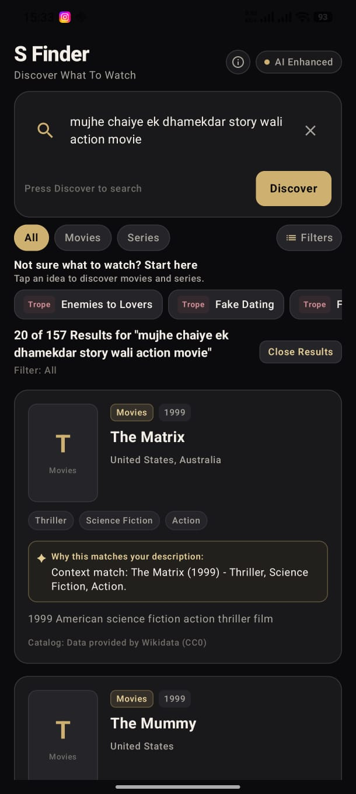
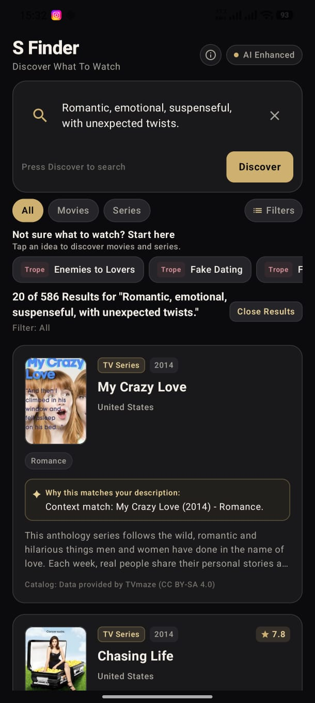
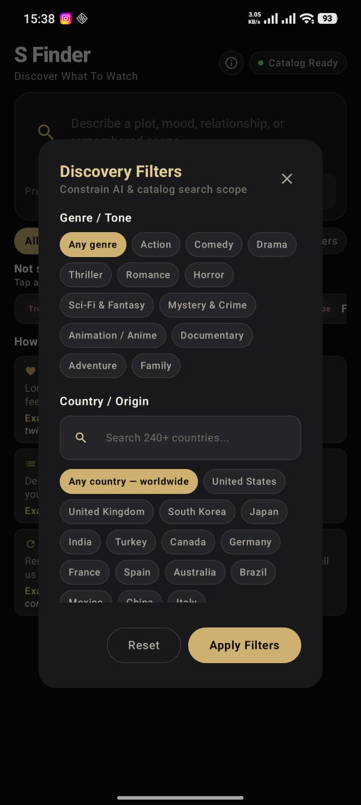
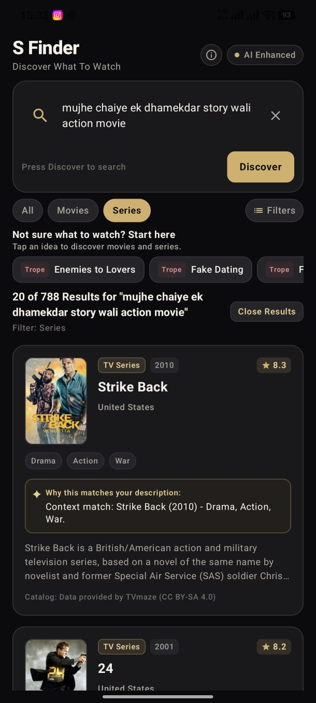

# S Finder — Discover Entertainment Smartly

[](https://www.android.com/)
[](https://kotlinlang.org/)
[](https://developer.android.com/jetpack/compose)
[](https://workers.cloudflare.com/)
[](https://ai.google.dev/)

**S Finder** is a modern Android entertainment-discovery application engineered to help users find movies and TV series effortlessly—especially when they cannot remember the exact title.

Powered by a hybrid search engine combining **SQLite FTS5 full-text indexing** with **Google Gemini AI semantic query analysis**, S Finder allows users to search using natural descriptions, remembered plot points, character dynamics, cinematic tropes, moods, Hindi/Hinglish expressions, or imperfectly typed queries.

---

## App Screenshots

| Branded Splash Screen | Home & Discovery Screen | Natural Language & Hinglish |
| :---: | :---: | :---: |
|  |  |  |
| *Midnight Cinema branded launch screen with uncropped emblem & tagline* | *Exploration interface with category chips, suggestions & search input* | *Natural language, plot recall & Hinglish query normalization* |

| AI-Powered Search Results | Interactive Filter Dialog | Filtered Results & Pagination |
| :---: | :---: | :---: |
|  |  |  |
| *Semantic match explanations, genre tags, ratings, and release years* | *Granular filtering by Media Type (Movies/Series), Genre, and Country* | *Multi-criteria filtered results with seamless "Load More" pagination* |

---

## Key Features

* **Natural-Language Story & Plot Recall**: Search for films and shows using vague recollections, memorable scenes, or thematic descriptions (e.g., *"plane crash survivors on a mysterious island with supernatural secrets"*).
* **Cinematic Trope & Relationship Discovery**: Supports deep trope searches such as *"enemies to lovers"*, *"time loop reliving the past"*, *"heist where the plan goes completely wrong"*, or *"detective with amnesia"*.
* **Mood & Vibe Search**: Match your current viewing mood—discover *"wholesome heartwarming family comedies"*, *"dark suspenseful psychological thrillers with unexpected twists"*, or *"epic historical war dramas"*.
* **Multilingual & Hinglish Query Normalization**: Intelligently handles colloquial Hindi, Hinglish, and bilingual queries (e.g., *"mujhe ek romantic movie chahiye jisme unexpected twist ho"* or *"dhamakedar action film"*).
* **Typo-Tolerant Retrieval**: Recovers from spelling slips, transposed characters, and phonetic approximations across both titles and plot terms.
* **Unified Movies & TV Series Catalog**: Seamlessly explore both feature films and episodic series, or restrict queries strictly to Movies or TV Series with one tap.
* **Match Explanations**: Every result card displays a concise explanation clarifying *why* the title matches your specific story or search context.
* **Infinite Discovery (Pagination)**: Browse extensive catalogs with responsive, state-preserving "Load More Results" pagination.
* **Midnight Cinema Visual Identity**: A distraction-free dark interface crafted with deep obsidian (`#0B0B0D`), champagne gold accents (`#D4AF65`), and subtle velvet burgundy touches (`#78303C`).
* **Branded Splash Screen**: A non-blocking, smooth startup presentation displaying the official S Finder emblem, tagline (*Discover What To Watch*), and brand credit (*From KAVTORS*).

---

## Technology Stack

### Android Client
* **Language**: Kotlin 2.2.10
* **UI Framework**: Jetpack Compose with Material 3 (Compose BOM `2026.02.01`)
* **Architecture**: MVVM with Kotlin Coroutines, StateFlow, and immutable UI state
* **Platform Target**: Android SDK compileSdk 36, targetSdk 36, minSdk 26 (Android 8.0+)
* **Testing**: JUnit 4, AndroidX Espresso, AndroidX Compose UI Test

### Backend & Cloud Infrastructure
* **Runtime**: Cloudflare Workers (TypeScript, Node.js compatibility mode)
* **Database**: Cloudflare D1 (Serverless distributed SQLite database with FTS5 virtual tables)
* **AI Intelligence**: Google Gemini API (`gemini-3.1-flash-lite`) for intent understanding and semantic re-ranking
* **Metadata Enrichment**: TVmaze REST API for supplemental broadcast metadata and verified posters
* **Testing**: Node.js test runner with TypeScript execution (227 tests across 38 suites)

---

## Architecture Overview

```
┌─────────────────────────────────────────────────────────────┐
│                   Android Client (Jetpack Compose)          │
│  - SearchInputBar & CategoryTabs                            │
│  - FilterDialog (MediaType, Genre, Country)                 │
│  - EntertainmentCard & ResultsList                          │
│  - Non-blocking Branded SplashScreen & Crossfade            │
└──────────────────────────────┬──────────────────────────────┘
                               │ HTTPS (REST API)
                               ▼
┌─────────────────────────────────────────────────────────────┐
│              Cloudflare Worker (sfinder-backend)            │
│  1. Query Analyzer & Normalizer (Hinglish/Typo mapping)     │
│  2. Media-Type Intent Classifier (Movie vs. TV Series)      │
│  3. Hybrid Candidate Retrieval:                             │
│     - SQLite FTS5 Match (BM25 weighted ranking)             │
│     - Curated Trope & Keyword indexing                      │
│  4. Gemini AI Semantic Ranker (Contextual relevance score)  │
│  5. Deterministic Offline Fallback Ranker                   │
└──────────────────────────────┬──────────────────────────────┘
                               │
                ┌──────────────┴──────────────┐
                ▼                             ▼
   ┌───────────────────────────┐ ┌───────────────────────────┐
   │ Cloudflare D1 (Database)  │ │      TVmaze Web API       │
   │ - catalog_items           │ │  - Live poster fallback   │
   │ - catalog_fts (FTS5)      │ │  - Supplemental series    │
   │ - 4,700+ verified records │ └───────────────────────────┘
   └───────────────────────────┘
```

1. **Client Responsibility**: Captures raw user queries, manages filter selections, handles infinite scrolling pagination, and renders high-density cards with ratings and match rationales.
2. **Backend Responsibility**: Normalizes colloquial/Hinglish queries, determines media-type intent, retrieves candidate records from D1 using FTS5, scores candidates against the user's storyline with Gemini AI, and outputs structured, paginated JSON responses.

---

## Project Structure

```
S-Finder/
├── app/                                  # Android application module
│   ├── src/
│   │   ├── main/
│   │   │   ├── java/com/kunal/sfinder/
│   │   │   │   ├── data/                 # Repositories & API clients
│   │   │   │   │   ├── remote/ai/        # Cloudflare Worker REST client
│   │   │   │   │   └── repository/       # Catalog repository implementations
│   │   │   │   ├── domain/               # Domain models & repository interfaces
│   │   │   │   ├── ui/
│   │   │   │   │   ├── components/       # Reusable Compose widgets
│   │   │   │   │   ├── home/             # HomeScreen & search view model
│   │   │   │   │   ├── splash/           # Branded SplashScreen composable
│   │   │   │   │   └── theme/            # Midnight Cinema colors, typography & theme
│   │   │   │   └── MainActivity.kt       # Single-activity entry point & edge-to-edge setup
│   │   │   ├── res/                      # Drawables, mipmaps, strings, colors, themes
│   │   │   └── AndroidManifest.xml       # Manifest configuration
│   │   ├── test/                         # JVM Unit Tests (35 tests)
│   │   └── androidTest/                  # On-Device Instrumentation Tests (3 tests)
│   └── build.gradle.kts                  # App-level build configuration
├── sfinder-backend/                      # Cloudflare Worker backend
│   ├── src/
│   │   ├── catalog/                      # D1 database access & FTS5 queries
│   │   ├── discovery/                    # Query analysis, media filtering & ranking
│   │   ├── gemini/                       # Gemini API client & prompt engineering
│   │   └── index.ts                      # Worker router & entry point
│   ├── migrations/                       # D1 SQLite migration scripts
│   ├── test/                             # Backend test suites (227 tests)
│   ├── wrangler.toml                     # Cloudflare Worker configuration
│   ├── .dev.vars.example                 # Example local environment variables
│   └── package.json                      # Node.js dependencies & scripts
├── screenshots/                          # Verified UI capture gallery
├── keystore.properties.example           # Example keystore configuration
├── .gitignore                            # Comprehensive security & build exclusions
├── build.gradle.kts                      # Root Gradle build script
└── settings.gradle.kts                   # Project module settings
```

---

## Getting Started

### 1. Android Client Setup

#### Prerequisites
* **Android Studio**: Ladybug (2024.2.1) or newer
* **JDK**: Version 17 or 21
* **Android SDK**: API 36 with Build-Tools 36.x

#### Build & Run
1. Clone the repository:
   ```bash
   git clone https://github.com/programmer-kunal/S-Finder.git
   cd S-Finder
   ```
2. Open the project in Android Studio.
3. Allow Gradle to sync dependencies.
4. Run the debug build on an emulator or connected physical device:
   ```bash
   ./gradlew installDebug
   ```

#### (Optional) Release Signing Setup
To generate a release build locally:
1. Copy `keystore.properties.example` to `keystore.properties`:
   ```bash
   cp keystore.properties.example keystore.properties
   ```
2. Fill in your keystore path, alias, and passwords.
3. Build the release bundle:
   ```bash
   ./gradlew bundleRelease
   ```
> **Security Notice**: Never commit `keystore.properties` or keystore files (`*.jks`) to version control.

---

### 2. Backend Setup

#### Prerequisites
* **Node.js**: v18.0.0 or higher
* **npm**: v9.0.0 or higher
* **Cloudflare Wrangler CLI**: Installed locally via npm

#### Local Development
1. Navigate to the backend directory:
   ```bash
   cd sfinder-backend
   npm install
   ```
2. Copy the example environment file:
   ```bash
   cp .dev.vars.example .dev.vars
   ```
3. Add your Gemini API key in `.dev.vars`:
   ```ini
   GEMINI_API_KEY=your_actual_gemini_api_key_here
   ```
4. Start the local development server:
   ```bash
   npx wrangler dev
   ```
   The local discovery endpoint will be available at `http://127.0.0.1:8787/api/v1/discover`.

---

## Configuration and Security

* **Credential Protection**: Real API keys, keystores, passwords, and environment files (`.env`, `.dev.vars`, `keystore.properties`, `local.properties`) are strictly ignored via `.gitignore`.
* **Zero Secret Logging**: The backend logging layer sanitizes all outgoing error logs and explicitly redacts API keys and sensitive tokens before writing to console or monitoring.
* **Deterministic Fallback**: In the event that external AI services experience latency or quota limits, the backend automatically falls back to local FTS5 BM25 candidate scoring without dropping service availability.

---

## Testing

### Android Unit & Instrumentation Tests
Run automated unit tests:
```bash
./gradlew testDebugUnitTest
```
*Result: 35/35 tests passing across 6 test suites.*

Run physical device instrumentation tests:
```bash
./gradlew connectedDebugAndroidTest
```
*Result: 3/3 tests passing on physical device (Splash Screen rendering, Query preservation, Pagination).*

### Backend Tests
Run the comprehensive backend suite:
```bash
cd sfinder-backend
npm test
```
*Result: 227/227 tests passing across 38 suites.*

---

## Current Status and Roadmap

* **Current Milestone (Version 1.0 Release Candidate)**:
  * Signed Android App Bundle (`S-Finder-v1.aab`) verified and ready for closed testing.
  * Cloudflare Worker backend deployed to production with Cloudflare D1 database.
  * Verified on physical hardware (Xiaomi POCO F6, Android 16).
* **Future Roadmap**:
  * Personalized watchlists and local bookmarking.
  * Streaming platform availability badges (e.g., Netflix, Prime Video, Disney+).
  * Offline search history and trending community trope suggestions.

---

## Attribution and Acknowledgements

* **TVmaze**: Supplemental TV series metadata, broadcast schedules, and poster imagery are provided by [TVmaze.com](https://www.tvmaze.com) under the [CC BY-SA 4.0](https://creativecommons.org/licenses/by-sa/4.0/) license.
* **Wikidata**: Movie and series catalog knowledge graph data derived from [Wikidata](https://www.wikidata.org) under the [Creative Commons CC0 License](https://creativecommons.org/publicdomain/zero/1.0/).

---

## License

Copyright © 2026 KAVTORS / Kunal. All rights reserved.  
*All rights reserved. Proprietary software. Reuse, redistribution, or modification permissions have not been granted through an open-source license.*
